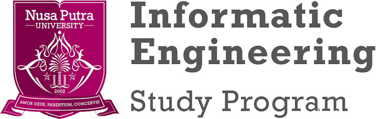

<div align="center">


<br/>



<br/><br/>

<a href="https://github.com/adefikri011/Sumbission-LiveCoding-Algoritma-AdeFikri">
  
</a>

<br/>


</div>

---

##  Tentang Repository

Repository ini adalah tempat **pengumpulan hasil Live Coding** mata kuliah **Algoritma dan Struktur Data**.
Setiap sesi live coding akan di-*push* ke sini, jadi isi repo ini akan **terus bertambah dan aktif** sepanjang perkuliahan berlangsung.

>  *"Belajar coding itu bukan soal hafal syntax, tapi soal terbiasa memecahkan masalah satu per satu."*

---

##  Identitas Mahasiswa

<div align="center">

| | |
|:---|:---|
|  **Nama** | Ade Fikri |
|  **NIM** | `20260040168` |
|  **Kelas** | TI26F |
|  **Mata Kuliah** | Algoritma dan Struktur Data |
|  **Program Studi** | Teknik Informatika |
|  **Universitas** | Nusa Putra University |

</div>

---

---

##  Daftar Sesi Live Coding

<details open>
<summary> <b>Session 2 — Variable dan Tipe Data</b></summary>
<br/>

| File | Deskripsi | Status |
|:---|:---|:---:|
| [`BillingPay.java`](src/session2/BillingPay.java) | Kalkulator *split bill*: hitung biaya layanan, tip, dan total per orang |  |
| [`KedaiKopi.java`](src/session2/KedaiKopi.java) | Program studi kasus Kedai Kopi |  |
| [`NilaiAkhir.java`](src/session2/NilaiAkhir.java) | Program penghitung nilai akhir |  |

</details>

<details open>
<summary> <b>Session 3 — Kondisi Percabangan</b></summary>
<br/>

| File | Deskripsi | Status |
|:---|:---|:---:|
| [`PersegiFC.java`](src/Session3/PersegiFC.java) | Latihan live coding Persegi FC |  |

</details>

<details open>
<summary> <b>Session 4 — Palindrome</b></summary>
<br/>

| File | Deskripsi | Status |
|:---|:---|:---:|
| [`TextPalindrome.java`](src/Session4/TextPalindrome.java) | Mengecek apakah sebuah teks termasuk palindrome |  |
| [`NextPalindrome.java`](src/Session4/NextPalindrome.java) | Mencari palindrome berikutnya |  |

</details>

<details>
<summary> <b>Session 5 dan seterusnya</b></summary>
<br/>

Akan ditambahkan seiring berjalannya sesi live coding. Stay tuned! 

</details>

---


##  Progress Live Coding

```text
Session 2  ██████████ 100%  ✓
Session 3  ██████████ 100%  ✓
Session 4  ██████████ 100%  ✓
Session 5  ░░░░░░░░░░   0%  ○ coming soon
```

---

##  Konvensi Commit

Repo ini memakai pesan commit yang rapi dan konsisten:

| Prefix | Fungsi |
|:---|:---|
| `feat :` | Menambahkan file / fitur baru |
| `fix :` | Memperbaiki bug atau kesalahan |
| `docs :` | Perubahan dokumentasi |
| `refactor :` | Merapikan kode tanpa mengubah hasil |

---

<div align="center">

###  Let's Connect

[](https://github.com/adefikri011)

<br/>

<b>Dibuat dengan  dan  oleh Ade Fikri</b>
<br/>
*TI26F • Nusa Putra University*

<br/>


</div>